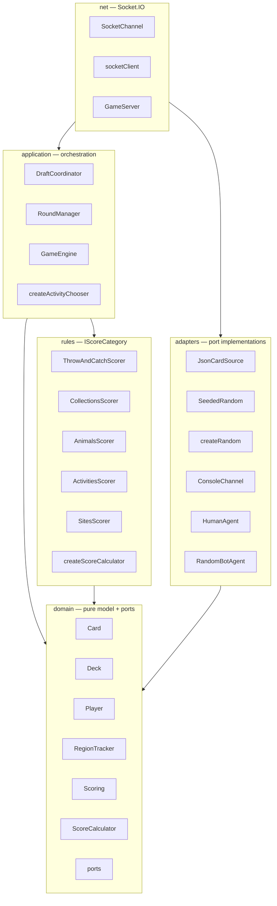
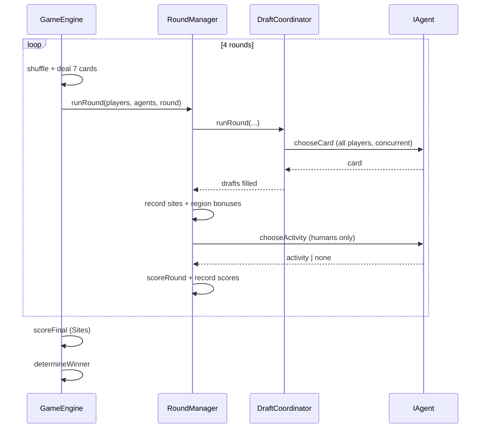

# Boomerang: Australia — Node.js backend

A multiplayer **draft-and-write** card game for 2–4 players, built with
TypeScript (strict), Express, and Socket.IO. The project is a design
exercise in **clean architecture**: the core game model is pure and knows
nothing about JSON files, sockets, or the console, while all I/O sits behind
narrow ports.

## Requirements

- Node.js >= 20
- npm

## Setup

```powershell
npm install
```

## Commands

```powershell
npm run typecheck   # tsc --noEmit
npm test            # node --import tsx --test "tests/**/*.test.ts"
npm run build       # tsc -> dist/
npm start -- <numPlayers> <numBots> [seed] [cardSet]
npm start -- <IP>
npm run dev         # tsx watch src/index.ts
```

## Running a game

The CLI mirrors the original Java entry point:

```powershell
# Local game: 1 human on the console + 2 bots
npm start -- 1 2

# Server hosting 1 local human + 1 remote human + 1 bot
npm start -- 2 1

# Remote client (connects to a server; PORT env, default 3000)
npm start -- 127.0.0.1
```

`numPlayers` is the number of **human** players (including the local one),
`numBots` is the number of bots, and the total must be 2–4. The optional
`seed` makes a game reproducible; when omitted the game starts from a random
seed. The optional `cardSet` picks the deck + scoring values (default
`australia`).

## Card sets

A card set is one config object in [src/cards](src/cards/) — its JSON deck,
region size, and the collection/animal point values. To add **Boomerang USA**:

1. Add `src/cards/usa/cards.json` (same shape as the Australia file).
2. Add `src/cards/usa.ts` exporting a `CardSetConfig`.
3. Register it in the `CARD_SETS` map in [src/cards/cardSets.ts](src/cards/cardSets.ts).

No rule, orchestration, or engine changes are needed — the scorers receive
the value tables through their constructors.

## Architecture (hexagonal / ports & adapters)

Dependencies point **inward**. The domain layer has no imports from the
outside world; adapters and the network layer implement the domain's ports.

```
src/
  domain/        pure model + ports (no I/O, no framework code)
  rules/         concrete IScoreCategory implementations
  cards/         card set configs + JSON decks (australia, usa, ...)
  application/   DraftCoordinator, RoundManager, GameEngine
  adapters/      implementations of the ports
  net/           Socket.IO channel, client, and game server
  cli.ts         argument parsing + local game wiring
  index.ts       entry point
  server.ts      createServer() factory (Express + Socket.IO)
tests/           mirrors src/
```





## Scoring rules

| Stage | Rule |
|---|---|
| Every round | Throw & Catch, Collections, Animals, Activities, Region bonus |
| End of round 4 | Sites (1 pt per unique site collected) |

- **Throw & Catch** — `|throw card number − catch card number|`.
- **Collections** — sum item values (Leaves 1, Wildflowers 2, Shells 3,
  Souvenirs 5); double if the total is ≤ 7.
- **Animals** — pairs only: Kangaroos 3, Emus 4, Wombats 5, Koalas 7,
  Platypuses 9 (three-of-a-kind counts as one pair).
- **Activities** — at most one per round, each at most once per game;
  score table `[0, 2, 4, 7, 10, 15]` for 1..6 cards.
- **Region bonus** — every player completing an unclaimed region in the same
  round gets +3; the region is then locked.

## SOLID rationale

- **S — Single responsibility.** One class per concern. The old Java
  `roundScore()` monolith became five small `IScoreCategory` rules, plus
  `RegionTracker` for site/region state.
- **O — Open/closed.** `ScoreCalculator` is closed for modification and open
  for extension: new scoring rules plug in behind `IScoreCategory` without
  editing existing code. `IAgent` gives the same property for player types.
- **L — Liskov substitution.** `HumanAgent` and `RandomBotAgent` are
  interchangeable behind `IAgent`; `ConsoleChannel` and `SocketChannel` are
  interchangeable behind `IMessageChannel`.
- **I — Interface segregation.** The ports are narrow: `IAgent`,
  `IMessageChannel`, `ICardSource`, `IRandom`, `IScoreCategory`. No client is
  forced to depend on methods it does not use.
- **D — Dependency inversion.** `Deck` depends on `IRandom`, not on a concrete
  RNG; `GameEngine` depends on `ScoreCalculator`, `RoundManager`, and `IRandom`
  abstractions; concrete adapters implement the ports.

## Booch metrics rationale

- **Coupling** is kept low and one-directional: `domain` depends on nothing,
  `rules`/`application` depend on `domain`, and `adapters`/`net` implement
  ports. Changing a rule never ripples into the model.
- **Cohesion** is high: every module has one clear job (a scorer scores one
  category, a coordinator runs one round of drafting).
- **Sufficiency and completeness** are balanced through the narrow ports —
  each interface declares exactly the operations its consumers need and no
  more.
- **Primitiveness** is preserved by keeping operations small and single
  purpose (`Deck.draw`, `Player.moveToDraft`, `RegionTracker.awardRoundBonuses`),
  which keeps the rules easy to test in isolation.

## Tests

`npm test` runs the suite (currently 92 tests) with `node:test`. Tests mirror
`src/` and double as documentation of each rule's behaviour, covering the
domain model, every scorer, the draft direction options, the round and game
orchestration, the CLI parser, and the Socket.IO channel protocol.
